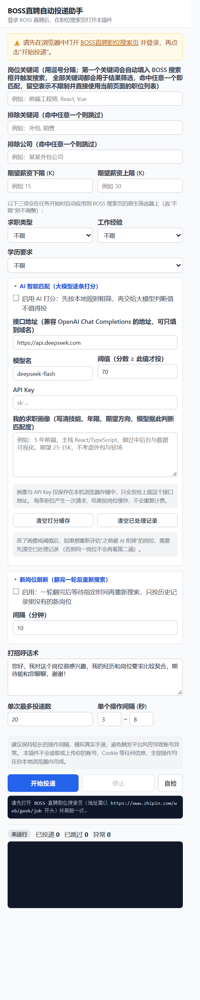

# BOSS直聘自动投递助手

一个 **Manifest V3** 浏览器扩展（Chrome / Edge 均可）：
登录 BOSS 直聘后，在职位搜索页点「开始投递」，插件会自动翻页、抓取职位详情、
用大模型判断匹配度，并给通过筛选的岗位打招呼。

> 本项目基于 [FanzhiZeng/BossAutoApply](https://github.com/FanzhiZeng/BossAutoApply)（MIT）改造而来。
> 上游版权归原作者所有，改造部分同样以 MIT 协议发布，详见 [LICENSE](LICENSE)。



---

## 与上游的差异（v0.2.0）

上游版本在实际使用中会卡在三个地方，这一版针对性做了改造：

| 问题 | 根因 | 本项目的处理 |
|---|---|---|
| 只能按标题+标签硬匹配 | `selectors.js` 定义了 `jobDesc` 却从未读取 JD | 同源 `fetch` 抓职位详情正文，JD 参与关键词/排除词匹配 |
| 翻不动页，只吃第一屏 | BOSS 已改成**滚动加载**，页面上没有"下一页"元素，上游逻辑找不到按钮就判定任务结束 | 无按钮时自动滚动到底触发加载（3 次重试），并用"列表签名"校验是否真的变长 |
| 操作不智能 | 只有本地规则 | 新增 **AI 打分**：把「求职画像 + 岗位信息 + JD」交给兼容 OpenAI 的大模型打 0-100 分，低于阈值跳过 |

另外修掉/加固的点：

- **翻页不再盲等**：点击后对比卡片列表签名与地址，真的变了才继续
- **页面跳转可续跑**：导航前落盘进度，新页面注入时自动接着跑（上游会静默丢任务）
- **招呼按钮悬停才渲染**：先派发 hover 事件再查找，并保护"点卡片后列表消失"的跳转场景
- **JD 抓取节流 + 失败分类**：`ok / blocked / empty` 三态判定，避免把正常页面误判成风控；
  被拦不缓存、连续失败自动延长暂停
- **进度快照持久化**：popup 关闭再打开能看到「上次记录」，不再丢失计数与日志
- **自检按钮**：一键输出当前页面各选择器的命中情况、首张卡片 DOM 结构、分页线索、JD 抓取结果

---

## 功能

- 自动把第一个关键词填进搜索框并触发搜索
- 按关键词 / 排除关键词 / 排除公司 / 薪资区间筛选
- 求职类型 / 工作经验 / 学历要求自动应用到 BOSS 原生筛选器
- **AI 智能打分**（可选）：模型读 JD 后给出分数与理由，低于阈值自动跳过
- **滚动加载**：自动滚到底加载更多岗位，直到没有新岗位
- **定时刷新**：一轮翻完后等待 N 分钟重新搜索，只投历史记录里没有的新岗位
- 自定义打招呼话术（见下方"已知限制"）
- 已投递/已跳过记录本地持久化，不重复打招呼；技术性失败不拉黑、下次重试
- 实时日志、工具栏角标显示已投递数、关闭弹窗后台继续运行

---

## 安装

### Edge
1. 打开 `edge://extensions`
2. 开启左下角「开发人员模式」
3. 点「加载解压缩的扩展」→ 选择本仓库根目录（含 `manifest.json` 的那一层）

### Chrome
1. 打开 `chrome://extensions`
2. 右上角开启「开发者模式」
3. 点「加载已解压的扩展程序」→ 选择本仓库根目录

装完后**必须刷新一次 BOSS 页面**，否则内容脚本不会注入到已打开的标签页。

---

## 快速开始

1. 登录 <https://www.zhipin.com>，进入职位搜索页（地址以 `https://www.zhipin.com/web/geek/job` 开头）
2. **手动设置城市**（插件不处理城市切换）
3. 点插件图标 → 先点「自检」确认选择器正常 → 填参数 → 「开始投递」

建议先用保守参数试跑：单次 3~5 个、间隔 8~12 秒。

---

## 配置说明

### 基本筛选

| 字段 | 说明 |
|---|---|
| 岗位关键词 | 逗号分隔。第一个自动填入搜索框；全部用于筛选（标题/标签/JD 命中任一即匹配）；留空=不限制 |
| 排除关键词 | 命中标题/标签/公司名/JD 即跳过 |
| 排除公司 | 公司名子串匹配 |
| 期望薪资 | 会尝试应用到 BOSS 原生「薪资待遇」筛选，并在本地二次过滤 |
| 求职类型 / 经验 / 学历 | 任务开始时自动点选对应原生筛选器，「不限」= 不调整 |
| 打招呼话术 | 见「已知限制」 |
| 单次最多投递数 | 达到即停止（上限 200） |
| 操作间隔 | 每个岗位之间的随机等待秒数 |

### AI 智能匹配（可选）

| 字段 | 说明 |
|---|---|
| 启用 AI 打分 | 勾选后每条候选岗位都会抓 JD 并请求模型 |
| 接口地址 | 兼容 OpenAI Chat Completions 的地址，可只填域名。默认 `https://api.deepseek.com` |
| 模型名 | 默认 `deepseek-flash` |
| API Key | 只存本机 `chrome.storage.local`，只发给你填的接口地址 |
| 判断标准 | **可选**，整段替换默认口径；画像怎么解读由你决定 |
| 求职画像 | 随便写（YAML/JSON/大白话），原样发给模型 |
| 阈值 | 分数 ≥ 此值才投递 |

插件只固定两件事：**输出 JSON 契约**（解析器依赖）与**画像原样透传**。
改了判断标准或画像会让打分缓存键变化，旧结论自动失效。

### 新岗位刷新

一轮岗位翻完后等待 N 分钟重新搜索，靠历史记录只投没投过的新岗位，
直到达到「单次最多投递数」或手动停止。

---

## 工作原理

```
┌──────────────┐   BA_START / BA_SELF_CHECK   ┌─────────────────────────┐
│   popup      │ ───────────────────────────► │  content script         │
│ (设置/日志)   │ ◄─────────────────────────── │  (搜索·翻页·抓JD·打招呼)  │
└──────────────┘        BA_PROGRESS           └───────────┬─────────────┘
       ▲                                                   │ BA_SCORE
       │ BA_GET_LATEST_STATE                               ▼
┌──────┴───────────────────────────────────────────────────────────────┐
│ background (service worker)                                          │
│  · 进度快照（session + local）  · 大模型代理（跨域请求只能在这里发）    │
│  · 打分缓存（画像+提示词+岗位+JD 的哈希键）  · 心跳保活                │
└──────────────────────────────────────────────────────────────────────┘
```

- 内容脚本不能跨域请求，模型调用全部经 background 代理
- MV3 的 service worker 默认 30 秒空闲回收，运行期间内容脚本每 20 秒 ping 一次保活
- 打分结果按「画像 + 提示词 + 岗位 + JD」哈希缓存，同一岗位不重复计费

### 目录结构

```
.
├── manifest.json                 # MV3 清单
├── package.json
├── src/
│   ├── background/background.js  # 进度快照 + 模型代理 + 打分缓存
│   ├── content/content.js        # 主流程：搜索/筛选/抓JD/打分/打招呼/滚动加载/续跑/自检
│   ├── popup/                    # 设置面板与日志
│   └── shared/
│       ├── utils.js              # 列表签名、hash、截断、退避、JD 抓取结果分类
│       ├── selectors.js          # 全部页面选择器（改版只改这里）
│       ├── matcher.js            # 纯函数：规则匹配（含 JD）
│       └── scoring.js            # 纯函数：提示词构建、响应解析、缓存键、阈值
├── test/                         # 44 个单元测试
├── tools/verify-extension.mjs    # 开发用：通过 CDP 加载扩展并验证
└── docs/使用说明.md              # 面向使用者的完整说明
```

---

## 开发

```bash
# 单元测试（Node 18+）
npm test
# 或直接跑单个文件（沙箱环境里 node --test 会因管道受限失败）
node test/scoring.test.js
```

`tools/verify-extension.mjs` 是一个开发辅助脚本：用 CDP 在 Edge 里加载未打包扩展、
检查 service worker 是否正常、渲染 popup 并截图。用法：

```bash
node tools/verify-extension.mjs <扩展路径> <临时配置目录> <截图路径> <日志路径>
```

注意它依赖 Windows + Edge 的默认安装路径，其他环境需要改脚本顶部的 `EDGE` 常量。

---

## 已知限制

1. **自定义话术常常不生效**：BOSS 现在点「立即沟通」后直接发送账号里的
   **默认招呼语**并弹「已向BOSS发送消息」，页面没有输入框。想改话术请去
   BOSS 网页版「消息通知 → 设置招呼语」修改。
2. **薪资数字抓不到**：BOSS 对薪资做了字体混淆，列表页 `textContent` 只剩 `-K·薪`。
   插件会尝试从详情页补，拿不到就静默跳过薪资过滤（不会误杀岗位）。
3. **滚动加载依赖页面结构**：若 BOSS 再次改版，请用「自检」按钮定位并更新 `selectors.js`。
4. 自动化操作可能违反 BOSS 直聘用户协议，**有封号风险**，请自行评估。

### BOSS 现网结构备忘（2026-11 实测）

- 卡片 `.job-card-box`；标题 `a.job-name`；公司 `a.boss-info > span.boss-name`；
  薪资 `span.job-salary`；标签 `ul.tag-list`；地区 `span.company-location`
- 列表为**滚动加载**，无"下一页"元素
- 卡片默认无招呼按钮，**悬停后**才渲染 `.op-btn`；点卡片会在右侧展开详情面板
- 点「立即沟通」多数情况直接发送默认招呼语

---

## 免责声明

本项目仅供个人学习与技术研究。使用自动化工具可能违反目标网站的用户协议，
由此产生的账号限制、封禁或其他后果由使用者自行承担，作者不承担任何责任。
请遵守相关法律法规与平台规则，控制频率、尊重招聘方。

---

## License

[MIT](LICENSE)

上游项目：[FanzhiZeng/BossAutoApply](https://github.com/FanzhiZeng/BossAutoApply) © FanzhiZeng
